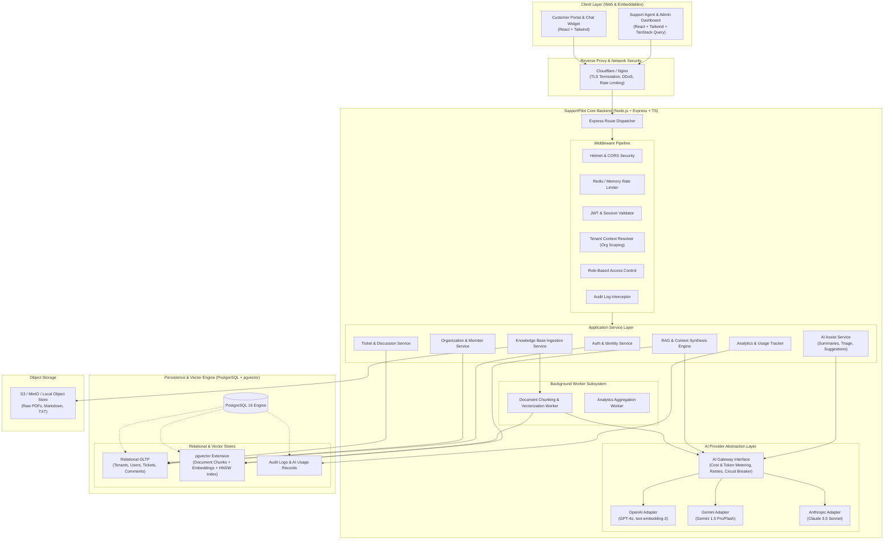
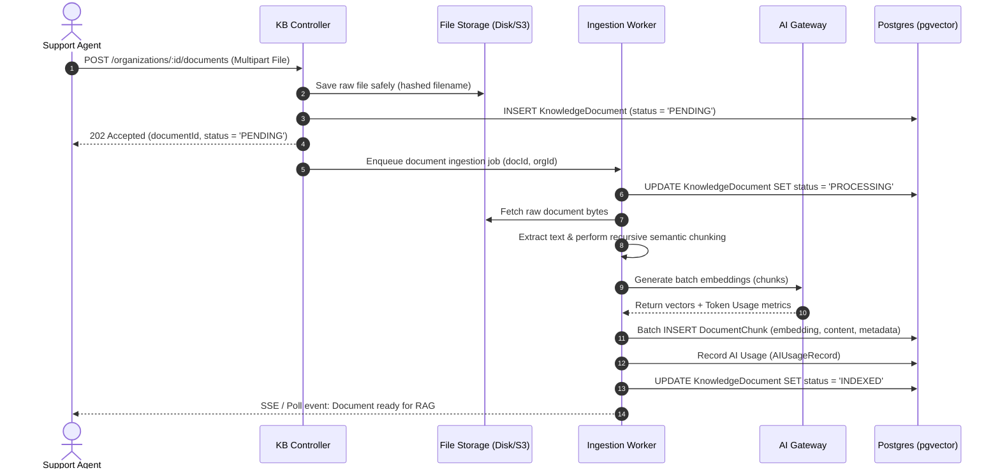

# SupportPilot AI — System Architecture Specification

## 1. Executive Summary & Vision

**SupportPilot AI** is an enterprise-grade, multi-tenant customer support and business automation software-as-a-service (SaaS) platform. The platform is designed to streamline customer support operations through intelligent automation, combining high-speed ticket lifecycle workflows with Retrieval-Augmented Generation (RAG) and specialized AI agent capabilities (summarization, triage classification, and smart response generation).

### Key Architectural Tenets
1. **Strict Multi-Tenancy & Data Isolation:** Logical separation of organizations where no customer, ticket, vector chunk, or audit trail can leak across organizational boundaries.
2. **Provider-Agnostic AI Abstraction:** A decoupled AI service gateway allowing seamless swapping and fallback among LLM providers (e.g., OpenAI, Anthropic, Google Gemini, local models) with comprehensive token accounting and cost tracking.
3. **Hybrid Scalability:** Separation of operational OLTP transactions (PostgreSQL) and low-latency similarity search (pgvector) inside a unified relational engine, minimizing distributed system complexity.
4. **Resilient Background Processing:** Asynchronous, decoupled ingestion and indexing pipelines for heavy documents, shielding user-facing APIs from latency spikes.
5. **Modern, Delightful User Experience:** Clean, responsive, glassmorphic UI built with React, Vite, and Tailwind CSS, providing real-time feedback and streamlined agent productivity.

---

## 2. High-Level System Architecture

The following diagram illustrates the complete end-to-end architecture of SupportPilot AI:



---

## 3. Component & Service Architecture

### 3.1 Frontend Architecture (`apps/web` or `client/`)
- **Framework & Tooling:** React 18+ with TypeScript, bundled using Vite for rapid HMR and optimized tree-shaken production bundles.
- **Styling & Design System:** Tailwind CSS with a customized design token system (dark-mode-first aesthetic, slate/indigo palette, micro-interactions, subtle glassmorphic surfaces, accessible contrast).
- **State Management & Data Fetching:**
  - **Server State:** TanStack Query (React Query) for caching, optimistic updates, background refetching, and pagination state.
  - **Client State:** Lightweight Zustand stores for active tenant context, session state, UI drawers/modals, and chat draft persistence.
- **Routing & Guards:** React Router 6+ with nested layout routes, authenticated wrappers, and role-based route guards (`<RequireAuth>`, `<RequireOrgRole role="AGENT">`).
- **Real-Time Communication:** EventSource (Server-Sent Events) or WebSocket connection for live ticket updates, incoming comments, and streaming AI assistant tokens.

### 3.2 Backend Layered Architecture (`apps/server` or `server/`)
The backend strictly follows a layered design to ensure single responsibility, testability, and maintainability:

```
┌────────────────────────────────────────────────────────┐
│ HTTP Request / Response                                │
├────────────────────────────────────────────────────────┤
│ 1. Routing & Input Validation Layer (Express + Zod)    │
│    - Strips unknown fields, validates types & limits   │
├────────────────────────────────────────────────────────┤
│ 2. Middleware & Context Pipeline                       │
│    - Authentication, Tenant Context, RBAC Guard, Audit │
├────────────────────────────────────────────────────────┤
│ 3. Service Layer (Business Logic)                      │
│    - TicketService, KnowledgeBaseService, RAGService   │
├────────────────────────────────────────────────────────┤
│ 4. AI Abstraction Gateway                              │
│    - Provider interface, Token Meter, Prompt Engine    │
├────────────────────────────────────────────────────────┤
│ 5. Data Access / Repository Layer (Prisma ORM)         │
│    - Scoped queries with mandatory organizationId      │
├────────────────────────────────────────────────────────┤
│ 6. Storage Tier (PostgreSQL with pgvector)             │
└────────────────────────────────────────────────────────┘
```

#### Middleware Pipeline Order:
1. `helmet()` & `cors(corsOptions)`
2. `express.json({ limit: '10mb' })`
3. `pinoHttp` request logger (assigns unique `requestId`)
4. `rateLimiterMiddleware` (IP and tenant-tier limits)
5. `authenticateToken` (Validates JWT, loads User entity)
6. `resolveTenantContext` (Extracts `organizationId` from path or header, verifies membership and role)
7. `requireRole(roles)` (Enforces role permissions: OWNER, AGENT, CUSTOMER)
8. `auditLogger` (Captures state changes for mutable endpoints)

### 3.3 AI Service Abstraction Layer
To guarantee provider independence, all AI operations are routed through the `AIGateway`:

```typescript
export interface EmbeddingOptions {
  dimensions?: number;
  model?: string;
}

export interface CompletionOptions {
  model?: string;
  temperature?: number;
  maxTokens?: number;
  stream?: boolean;
  systemPrompt?: string;
}

export interface AIUsageMetrics {
  promptTokens: number;
  completionTokens: number;
  totalTokens: number;
  estimatedCostUsd: number;
  latencyMs: number;
}

export interface AIProvider {
  id: string;
  generateEmbedding(text: string, options?: EmbeddingOptions): Promise<{ embedding: number[]; usage: AIUsageMetrics }>;
  generateEmbeddingsBatch(texts: string[], options?: EmbeddingOptions): Promise<{ embeddings: number[][]; usage: AIUsageMetrics }>;
  complete(prompt: string, options?: CompletionOptions): Promise<{ content: string; usage: AIUsageMetrics }>;
  completeStream?(prompt: string, options?: CompletionOptions, onChunk?: (token: string) => void): Promise<{ content: string; usage: AIUsageMetrics }>;
}
```

- **Metering & Guardrails:** Every AI call calculates consumed tokens, applies organization-level quotas, logs an immutable record in `AiUsageRecord`, and halts execution if token limits are exceeded.
- **Failover & Retries:** Exponential backoff with jitter on 429 (Rate Limit) and 503 (Provider Overloaded) errors.

### 3.4 Vector Search & RAG Architecture
- **Engine:** PostgreSQL using the official `pgvector` extension.
- **Distance Metric:** Cosine Distance (`<=>`), utilizing HNSW (Hierarchical Navigable Small World) indexing for $O(\log N)$ approximate nearest neighbor search.
- **Ingestion Workflow:**
  1. File Upload (PDF, Markdown, TXT, HTML) via multipart form.
  2. Extraction & Normalization into clean text.
  3. Recursive Semantic Chunking: Target chunk size of ~500 tokens with 50-token overlap to maintain contextual continuity.
  4. Batch Embedding Generation via `AIGateway`.
  5. Bulk Insert of `DocumentChunk` records containing vector embeddings and metadata.
- **Retrieval Workflow:**
  1. User query is converted to an embedding vector.
  2. SQL similarity query executed with **strict organization scoping**:
     ```sql
     SELECT id, document_id, content, metadata, 
            1 - (embedding <=> $1::vector) AS similarity
     FROM document_chunks
     WHERE organization_id = $2
       AND 1 - (embedding <=> $1::vector) >= $3
     ORDER BY embedding <=> $1::vector ASC
     LIMIT $4;
     ```
  3. Retrieved top-$k$ chunks (default $k=5$) formatted into a prompt context window with strict system guidelines.
  4. Synthesized answer produced with explicit inline citations.

---

## 4. Multi-Tenancy & Isolation Architecture

SupportPilot AI enforces a **Single Database, Shared Schema with Tenant Discriminator** strategy.

### Tenant Isolation Mechanics:
1. **Tenant Anchor:** Every tenant-scoped entity (`Ticket`, `TicketComment`, `KnowledgeDocument`, `DocumentChunk`, `AuditLog`, `AiUsageRecord`, etc.) contains a non-nullable `organizationId` foreign key.
2. **Compound Unique Keys & Indexing:** All primary identifiers and lookups incorporate `organizationId` (e.g., `@@unique([organizationId, ticketNumber])`, `@@index([organizationId, status])`).
3. **Prisma Tenant Extension:** Backend queries use a customized Prisma Client extension that automatically injects `where: { organizationId }` on all reads, updates, and deletes, preventing developer oversight from causing cross-tenant data leaks.
4. **Role Isolation:**
   - **Organization Owner:** Complete administrative oversight, billing, team membership management, AI configuration.
   - **Support Agent:** Full access to all tickets, internal notes, KB management, and AI assist tools within the organization.
   - **Customer:** Scoped strictly to their own created tickets and comments; cannot view internal agent notes (`isInternal = true`) or unapproved documents.

---

## 5. Proposed Folder & Workspace Structure

We adopt a structured monorepo/multi-package layout for clean separation of concerns, shared types, and independent deployability:

```
supportpilot-ai/
├── .github/                      # CI/CD Workflows, issue templates
│   └── workflows/
│       ├── test-and-lint.yml     # Vitest & lint checks
│       └── docker-build.yml      # Container build pipelines
├── docs/                         # Architecture, API, DB, Security specs
│   ├── ARCHITECTURE.md
│   ├── DATABASE.md
│   ├── API.md
│   ├── SECURITY.md
│   └── IMPLEMENTATION_PLAN.md
├── packages/
│   └── shared-types/             # Shared TypeScript DTOs, Enums, Zod schemas
│       ├── package.json
│       ├── tsconfig.json
│       └── src/
│           ├── index.ts
│           ├── auth.ts
│           ├── tickets.ts
│           ├── kb.ts
│           ├── ai.ts
│           └── organizations.ts
├── apps/
│   ├── client/                   # Frontend SPA (React + Vite + Tailwind)
│   │   ├── index.html
│   │   ├── package.json
│   │   ├── postcss.config.js
│   │   ├── tailwind.config.js
│   │   ├── tsconfig.json
│   │   ├── vite.config.ts
│   │   ├── public/
│   │   └── src/
│   │       ├── assets/           # Icons, brand assets, illustrations
│   │       ├── components/       # Reusable atomic UI components
│   │       │   ├── ui/           # Buttons, Inputs, Dialogs, Badges, Tabs
│   │       │   ├── layout/       # Sidebar, Header, OrgSwitcher, PageContainer
│   │       │   ├── tickets/      # TicketTable, TicketDetail, CommentThread
│   │       │   ├── kb/           # DocumentUploader, ChunkInspector
│   │       │   └── chat/         # ChatWidget, MessageList, CitationPill
│   │       ├── context/          # React Contexts (AuthContext, OrgContext)
│   │       ├── hooks/            # Custom hooks (useAuth, useTickets, useRAG)
│   │       ├── lib/              # Axios/Fetch client, queryClient, utils
│   │       ├── pages/            # View pages
│   │       │   ├── auth/         # Login, Register, InviteAccept
│   │       │   ├── dashboard/    # Agent & Owner Overview Dashboard
│   │       │   ├── tickets/      # Ticket List, Ticket Create, Ticket Workspace
│   │       │   ├── kb/           # Document Management, Knowledge Base
│   │       │   ├── analytics/    # Token Usage, Volume Metrics, SLA stats
│   │       │   ├── settings/     # Org Settings, Team Members, API Keys
│   │       │   └── portal/       # Customer-facing ticket view & widget
│   │       ├── routes/           # AppRoutes and route guard definitions
│   │       └── types/            # Client-specific state types
│   │
│   └── server/                   # Backend API (Node.js + Express + Prisma)
│       ├── package.json
│       ├── tsconfig.json
│       ├── prisma/
│       │   ├── schema.prisma     # Prisma models, relations & pgvector definitions
│       │   ├── migrations/       # SQL migrations
│       │   └── seed.ts           # Demo orgs, users, tickets & embeddings
│       ├── src/
│       │   ├── app.ts            # Express application bootstrap & middleware
│       │   ├── server.ts         # HTTP listener & graceful shutdown
│       │   ├── config/           # Environment variables & constants
│       │   ├── constants/        # System error codes, role definitions
│       │   ├── controllers/      # Route request/response handlers
│       │   │   ├── auth.controller.ts
│       │   │   ├── org.controller.ts
│       │   │   ├── ticket.controller.ts
│       │   │   ├── comment.controller.ts
│       │   │   ├── kb.controller.ts
│       │   │   ├── rag.controller.ts
│       │   │   ├── ai-assist.controller.ts
│       │   │   ├── analytics.controller.ts
│       │   │   └── audit.controller.ts
│       │   ├── middleware/       # Express middlewares
│       │   │   ├── auth.middleware.ts
│       │   │   ├── tenant.middleware.ts
│       │   │   ├── rbac.middleware.ts
│       │   │   ├── validate.middleware.ts
│       │   │   ├── rate-limit.middleware.ts
│       │   │   ├── audit.middleware.ts
│       │   │   └── error.middleware.ts
│       │   ├── routes/           # Express router endpoints
│       │   │   └── v1/
│       │   │       ├── index.ts
│       │   │       ├── auth.routes.ts
│       │   │       ├── org.routes.ts
│       │   │       ├── ticket.routes.ts
│       │   │       ├── kb.routes.ts
│       │   │       ├── rag.routes.ts
│       │   │       ├── ai.routes.ts
│       │   │       └── analytics.routes.ts
│       │   ├── services/         # Core business logic
│       │   │   ├── auth.service.ts
│       │   │   ├── org.service.ts
│       │   │   ├── ticket.service.ts
│       │   │   ├── comment.service.ts
│       │   │   ├── kb.service.ts
│       │   │   ├── rag.service.ts
│       │   │   ├── ai-assist.service.ts
│       │   │   ├── analytics.service.ts
│       │   │   └── audit.service.ts
│       │   ├── ai/               # AI provider abstraction
│       │   │   ├── ai.gateway.ts
│       │   │   ├── providers/
│       │   │   │   ├── openai.provider.ts
│       │   │   │   ├── gemini.provider.ts
│       │   │   │   └── mock.provider.ts
│       │   │   └── prompts/      # Tested system prompts & templates
│       │   │       ├── rag-chat.prompt.ts
│       │   │       ├── summarize.prompt.ts
│       │   │       ├── classify.prompt.ts
│       │   │       └── reply-suggestion.prompt.ts
│       │   ├── workers/          # Background worker tasks
│       │   │   └── chunking.worker.ts
│       │   ├── repositories/     # Data queries & vector search adapters
│       │   │   ├── db.ts         # Prisma client instance with tenant extensions
│       │   │   └── vector.repo.ts# Raw SQL queries for pgvector similarity
│       │   └── utils/            # Tokenizers, hashing, sanitization helpers
│       └── tests/                # Automated Vitest test suites
│           ├── unit/             # Unit tests for services & AI parsers
│           ├── integration/      # Supertest API tests for endpoints
│           └── mocks/            # Mock database and AI provider stubs
├── docker/                       # Dockerfiles and compose specs
│   ├── docker-compose.yml        # PostgreSQL with pgvector + Server + Client
│   ├── Dockerfile.server
│   └── Dockerfile.client
├── .env.example                  # Environment variable reference
├── package.json                  # Root monorepo workspace configuration
└── README.md                     # Project overview and runbook
```

---

## 6. Asynchronous Document Processing Pipeline

Ingestion of PDF/Markdown documents for RAG requires non-blocking background execution:



---

## 7. Observability, Logging & Error Management

- **Structured JSON Logging:** Pino logger outputting structured JSON with `level`, `timestamp`, `requestId`, `organizationId`, and `userId`.
- **Centralized Error Handling:**
  - Standardized custom error classes extending `AppError` (`NotFoundError`, `UnauthorizedError`, `ForbiddenError`, `ConflictError`, `ValidationError`, `AiQuotaExceededError`).
  - Global Express error handling middleware converting unexpected errors to sanitised JSON responses (`500 Internal Server Error`) while preserving detailed stack traces in secure server logs.
- **Audit Trails:** Immutable logging of security-critical actions (ticket assignment, role modification, KB document deletion, configuration updates) with IP addresses and user agents.
