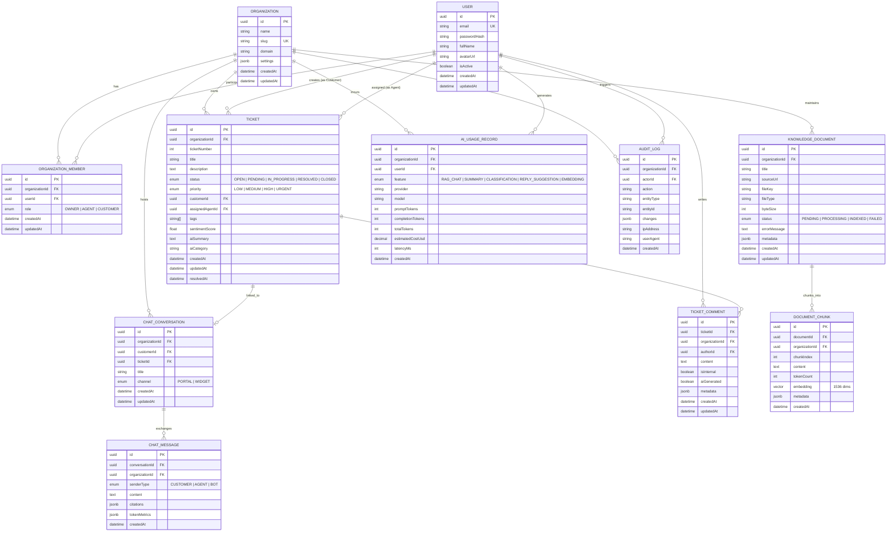

# SupportPilot AI — Database Architecture & Schema Specification

## 1. Database Overview & Technology Stack

- **Engine:** PostgreSQL 16+
- **Extensions:**
  - `pgcrypto` / `uuid-ossp`: High-performance cryptographic UUID generation.
  - `vector`: The official `pgvector` extension for storing and performing low-latency vector similarity search on high-dimensional embeddings.
- **Object-Relational Mapping:** Prisma ORM 5.x+
- **Multi-Tenancy Model:** Logical isolation via a tenant discriminator (`organizationId`) across all relational and vector tables, paired with strict compound indexing and application-level tenant isolation middleware.

---

## 2. Multi-Tenant Data Model & Isolation Strategy

Every operational table in SupportPilot AI belongs directly to an `Organization`.

### Core Rules for Multi-Tenant Data Integrity:
1. **Mandatory Foreign Keys:** Every entity (excluding `User` and `Organization` root models) has a non-nullable `organizationId` referencing `Organization(id) ON DELETE CASCADE`.
2. **Compound Unique Constraints:** Natural keys are scoped per organization (e.g., ticket sequence numbers are unique within an organization, not globally).
3. **Compound Tenant Indexes:** Every frequent query pattern is prefixed with `organizationId` (e.g., `[organizationId, status]`, `[organizationId, createdAt]`, `[organizationId, assignedAgentId]`).
4. **Tenant Scoped Vector Search:** Vector searches explicitly filter by `organization_id = $tenantId` before or during approximate nearest neighbor index traversal to guarantee 0% cross-tenant data leakage.

---

## 3. Entity-Relationship (ER) Diagram



---

## 4. Complete Prisma Schema (`schema.prisma`)

Below is the definitive Prisma schema with `pgvector` support and relational definitions:

```prisma
datasource db {
  provider   = "postgresql"
  url        = env("DATABASE_URL")
  extensions = [pgvector(map: "vector"), pgcrypto]
}

generator client {
  provider        = "prisma-client-js"
  previewFeatures = ["postgresqlExtensions"]
}

// ----------------------------------------------------
// Enums
// ----------------------------------------------------

enum OrgRole {
  OWNER
  AGENT
  CUSTOMER
}

enum TicketStatus {
  OPEN
  PENDING
  IN_PROGRESS
  RESOLVED
  CLOSED
}

enum TicketPriority {
  LOW
  MEDIUM
  HIGH
  URGENT
}

enum DocumentStatus {
  PENDING
  PROCESSING
  INDEXED
  FAILED
}

enum ChatSenderType {
  CUSTOMER
  AGENT
  BOT
}

enum ChatChannel {
  PORTAL
  WIDGET
}

enum AiFeature {
  RAG_CHAT
  TICKET_SUMMARY
  TICKET_CLASSIFICATION
  REPLY_SUGGESTION
  DOCUMENT_EMBEDDING
}

// ----------------------------------------------------
// Core Multi-Tenant & Identity Models
// ----------------------------------------------------

model Organization {
  id        String   @id @default(dbgenerated("gen_random_uuid()")) @db.Uuid
  name      String   @db.VarChar(128)
  slug      String   @unique @db.VarChar(64)
  domain    String?  @db.VarChar(255)
  settings  Json     @default("{\"ticketPrefix\": \"SP\", \"aiAutoReply\": false, \"ragConfidenceThreshold\": 0.70}") @db.JsonB
  createdAt DateTime @default(now()) @map("created_at")
  updatedAt DateTime @updatedAt @map("updated_at")

  // Relationships
  members            OrganizationMember[]
  tickets            Ticket[]
  ticketComments     TicketComment[]
  knowledgeDocuments KnowledgeDocument[]
  documentChunks     DocumentChunk[]
  chatConversations  ChatConversation[]
  chatMessages       ChatMessage[]
  aiUsageRecords     AiUsageRecord[]
  auditLogs          AuditLog[]

  @@map("organizations")
}

model User {
  id           String   @id @default(dbgenerated("gen_random_uuid()")) @db.Uuid
  email        String   @unique @db.VarChar(255)
  passwordHash String   @map("password_hash") @db.VarChar(255)
  fullName     String   @map("full_name") @db.VarChar(128)
  avatarUrl    String?  @map("avatar_url") @db.VarChar(1024)
  isActive     Boolean  @default(true) @map("is_active")
  createdAt    DateTime @default(now()) @map("created_at")
  updatedAt    DateTime @updatedAt @map("updated_at")

  // Relationships
  memberships       OrganizationMember[]
  createdTickets    Ticket[]             @relation("CustomerTickets")
  assignedTickets   Ticket[]             @relation("AgentTickets")
  comments          TicketComment[]
  auditLogs         AuditLog[]
  aiUsageRecords    AiUsageRecord[]

  @@map("users")
}

model OrganizationMember {
  id             String       @id @default(dbgenerated("gen_random_uuid()")) @db.Uuid
  organizationId String       @map("organization_id") @db.Uuid
  userId         String       @map("user_id") @db.Uuid
  role           OrgRole      @default(CUSTOMER)
  createdAt      DateTime     @default(now()) @map("created_at")
  updatedAt      DateTime     @updatedAt @map("updated_at")

  organization   Organization @relation(fields: [organizationId], references: [id], onDelete: Cascade)
  user           User         @relation(fields: [userId], references: [id], onDelete: Cascade)

  @@unique([organizationId, userId])
  @@index([userId])
  @@index([organizationId, role])
  @@map("organization_members")
}

// ----------------------------------------------------
// Ticket Management Models
// ----------------------------------------------------

model Ticket {
  id              String         @id @default(dbgenerated("gen_random_uuid()")) @db.Uuid
  organizationId  String         @map("organization_id") @db.Uuid
  ticketNumber    Int            @map("ticket_number")
  title           String         @db.VarChar(255)
  description     String         @db.Text
  status          TicketStatus   @default(OPEN)
  priority        TicketPriority @default(MEDIUM)
  customerId      String         @map("customer_id") @db.Uuid
  assignedAgentId String?        @map("assigned_agent_id") @db.Uuid
  tags            String[]       @default([])
  sentimentScore  Float?         @map("sentiment_score")
  aiSummary       String?        @map("ai_summary") @db.Text
  aiCategory      String?        @map("ai_category") @db.VarChar(64)
  createdAt       DateTime       @default(now()) @map("created_at")
  updatedAt       DateTime       @updatedAt @map("updated_at")
  resolvedAt      DateTime?      @map("resolved_at")

  organization  Organization    @relation(fields: [organizationId], references: [id], onDelete: Cascade)
  customer      User            @relation("CustomerTickets", fields: [customerId], references: [id], onDelete: Restrict)
  assignedAgent User?           @relation("AgentTickets", fields: [assignedAgentId], references: [id], onDelete: SetNull)
  comments      TicketComment[]
  conversations ChatConversation[]

  @@unique([organizationId, ticketNumber])
  @@index([organizationId, status])
  @@index([organizationId, priority])
  @@index([organizationId, customerId])
  @@index([organizationId, assignedAgentId])
  @@index([organizationId, createdAt(sort: Desc)])
  @@map("tickets")
}

model TicketComment {
  id             String       @id @default(dbgenerated("gen_random_uuid()")) @db.Uuid
  ticketId       String       @map("ticket_id") @db.Uuid
  organizationId String       @map("organization_id") @db.Uuid
  authorId       String       @map("author_id") @db.Uuid
  content        String       @db.Text
  isInternal     Boolean      @default(false) @map("is_internal")
  aiGenerated    Boolean      @default(false) @map("ai_generated")
  metadata       Json?        @db.JsonB
  createdAt      DateTime     @default(now()) @map("created_at")
  updatedAt      DateTime     @updatedAt @map("updated_at")

  ticket       Ticket       @relation(fields: [ticketId], references: [id], onDelete: Cascade)
  organization Organization @relation(fields: [organizationId], references: [id], onDelete: Cascade)
  author       User         @relation(fields: [authorId], references: [id], onDelete: Restrict)

  @@index([ticketId, createdAt(sort: Asc)])
  @@index([organizationId, authorId])
  @@map("ticket_comments")
}

// ----------------------------------------------------
// Knowledge Base & Vector Search Models
// ----------------------------------------------------

model KnowledgeDocument {
  id             String         @id @default(dbgenerated("gen_random_uuid()")) @db.Uuid
  organizationId String         @map("organization_id") @db.Uuid
  title          String         @db.VarChar(255)
  sourceUrl      String?        @map("source_url") @db.VarChar(1024)
  fileKey        String?        @map("file_key") @db.VarChar(512)
  fileType       String         @map("file_type") @db.VarChar(32)
  byteSize       Int            @map("byte_size")
  status         DocumentStatus @default(PENDING)
  errorMessage   String?        @map("error_message") @db.Text
  metadata       Json?          @db.JsonB
  createdAt      DateTime       @default(now()) @map("created_at")
  updatedAt      DateTime       @updatedAt @map("updated_at")

  organization Organization    @relation(fields: [organizationId], references: [id], onDelete: Cascade)
  chunks       DocumentChunk[]

  @@index([organizationId, status])
  @@map("knowledge_documents")
}

model DocumentChunk {
  id             String                                @id @default(dbgenerated("gen_random_uuid()")) @db.Uuid
  documentId     String                                @map("document_id") @db.Uuid
  organizationId String                                @map("organization_id") @db.Uuid
  chunkIndex     Int                                   @map("chunk_index")
  content        String                                @db.Text
  tokenCount     Int                                   @map("token_count")
  embedding      Unsupported("vector(1536)")?          // OpenAI text-embedding-3 or 768 for Gemini
  metadata       Json?                                 @db.JsonB
  createdAt      DateTime                              @default(now()) @map("created_at")

  document     KnowledgeDocument @relation(fields: [documentId], references: [id], onDelete: Cascade)
  organization Organization      @relation(fields: [organizationId], references: [id], onDelete: Cascade)

  @@index([organizationId])
  @@index([documentId])
  @@map("document_chunks")
}

// ----------------------------------------------------
// RAG Chatbot Conversations
// ----------------------------------------------------

model ChatConversation {
  id             String       @id @default(dbgenerated("gen_random_uuid()")) @db.Uuid
  organizationId String       @map("organization_id") @db.Uuid
  customerId     String?      @map("customer_id") @db.Uuid
  ticketId       String?      @map("ticket_id") @db.Uuid
  title          String       @default("New Support Conversation") @db.VarChar(255)
  channel        ChatChannel  @default(PORTAL)
  createdAt      DateTime     @default(now()) @map("created_at")
  updatedAt      DateTime     @updatedAt @map("updated_at")

  organization Organization  @relation(fields: [organizationId], references: [id], onDelete: Cascade)
  ticket       Ticket?       @relation(fields: [ticketId], references: [id], onDelete: SetNull)
  messages     ChatMessage[]

  @@index([organizationId, customerId])
  @@index([ticketId])
  @@map("chat_conversations")
}

model ChatMessage {
  id             String         @id @default(dbgenerated("gen_random_uuid()")) @db.Uuid
  conversationId String         @map("conversation_id") @db.Uuid
  organizationId String         @map("organization_id") @db.Uuid
  senderType     ChatSenderType @map("sender_type")
  content        String         @db.Text
  citations      Json?          @db.JsonB // Array of chunkIds, doc titles, snippets
  tokenMetrics   Json?          @map("token_metrics") @db.JsonB
  createdAt      DateTime       @default(now()) @map("created_at")

  conversation ChatConversation @relation(fields: [conversationId], references: [id], onDelete: Cascade)
  organization Organization     @relation(fields: [organizationId], references: [id], onDelete: Cascade)

  @@index([conversationId, createdAt(sort: Asc)])
  @@index([organizationId])
  @@map("chat_messages")
}

// ----------------------------------------------------
// Analytics, AI Metering & Audit Logs
// ----------------------------------------------------

model AiUsageRecord {
  id               String       @id @default(dbgenerated("gen_random_uuid()")) @db.Uuid
  organizationId   String       @map("organization_id") @db.Uuid
  userId           String?      @map("user_id") @db.Uuid
  feature          AiFeature
  provider         String       @db.VarChar(64)
  model            String       @db.VarChar(64)
  promptTokens     Int          @map("prompt_tokens")
  completionTokens Int          @map("completion_tokens")
  totalTokens      Int          @map("total_tokens")
  estimatedCostUsd Decimal      @map("estimated_cost_usd") @db.Decimal(10, 6)
  latencyMs        Int          @map("latency_ms")
  createdAt        DateTime     @default(now()) @map("created_at")

  organization Organization @relation(fields: [organizationId], references: [id], onDelete: Cascade)
  user         User?        @relation(fields: [userId], references: [id], onDelete: SetNull)

  @@index([organizationId, createdAt(sort: Desc)])
  @@index([organizationId, feature])
  @@map("ai_usage_records")
}

model AuditLog {
  id             String       @id @default(dbgenerated("gen_random_uuid()")) @db.Uuid
  organizationId String       @map("organization_id") @db.Uuid
  actorId        String?      @map("actor_id") @db.Uuid
  action         String       @db.VarChar(128) // e.g., TICKET_STATUS_CHANGED, MEMBER_INVITED
  entityType     String       @map("entity_type") @db.VarChar(64)
  entityId       String       @map("entity_id") @db.VarChar(64)
  changes        Json?        @db.JsonB // { before: {...}, after: {...} }
  ipAddress      String?      @map("ip_address") @db.VarChar(45)
  userAgent      String?      @map("user_agent") @db.VarChar(512)
  createdAt      DateTime     @default(now()) @map("created_at")

  organization Organization @relation(fields: [organizationId], references: [id], onDelete: Cascade)
  actor        User?        @relation(fields: [actorId], references: [id], onDelete: SetNull)

  @@index([organizationId, createdAt(sort: Desc)])
  @@index([organizationId, entityType, entityId])
  @@map("audit_logs")
}
```

---

## 5. Vector Search Query Implementation & Indexing Strategy

Prisma does not natively generate HNSW/IVFFlat index statements or execute custom vector operators in its high-level API. We combine Prisma for migrations and `$queryRaw` for vector similarity search.

### 5.1 Raw SQL Migration for pgvector Index
During database initialization, an explicit migration script creates the vector index:

```sql
-- Enable pgvector extension
CREATE EXTENSION IF NOT EXISTS vector;

-- Create Hierarchical Navigable Small World (HNSW) index for high recall and fast query times
-- Using cosine distance metric (vector_cosine_ops)
CREATE INDEX IF NOT EXISTS idx_document_chunks_embedding_hnsw
ON document_chunks
USING hnsw (embedding vector_cosine_ops)
WITH (m = 16, ef_construction = 64);
```

### 5.2 Tenant-Isolated Vector Search Query
In the backend repository layer (`vector.repo.ts`), vector similarity searches are executed via parameterized SQL:

```typescript
export async function searchSimilarChunks(
  organizationId: string,
  queryEmbedding: number[],
  matchThreshold: number = 0.65,
  limit: number = 5
): Promise<Array<{
  chunkId: string;
  documentId: string;
  documentTitle: string;
  content: string;
  similarity: number;
}>> {
  const vectorString = `[${queryEmbedding.join(',')}]`;

  const results = await prisma.$queryRaw<Array<{
    chunk_id: string;
    document_id: string;
    document_title: string;
    content: string;
    similarity: number;
  }>>`
    SELECT 
      c.id AS chunk_id,
      c.document_id,
      d.title AS document_title,
      c.content,
      1 - (c.embedding <=> ${vectorString}::vector) AS similarity
    FROM document_chunks c
    JOIN knowledge_documents d ON c.document_id = d.id
    WHERE c.organization_id = ${organizationId}::uuid
      AND d.status = 'INDEXED'
      AND (1 - (c.embedding <=> ${vectorString}::vector)) >= ${matchThreshold}
    ORDER BY c.embedding <=> ${vectorString}::vector ASC
    LIMIT ${limit};
  `;

  return results.map(row => ({
    chunkId: row.chunk_id,
    documentId: row.document_id,
    documentTitle: row.document_title,
    content: row.content,
    similarity: Number(row.similarity)
  }));
}
```

---

## 6. Seed Data Strategy

A robust development seed file (`prisma/seed.ts`) guarantees instant local environment readiness:
1. **Organizations:** 2 distinct demo tenants (`Acme Corp` slug: `acme`, `Beta Retail` slug: `beta`).
2. **Users:** 
   - Owner (`owner@acme.com`)
   - 2 Support Agents (`agent1@acme.com`, `agent2@acme.com`)
   - 2 Customers (`customer1@acme.com`, `customer2@acme.com`)
   - Passwords hashed using standard `argon2id` / `bcrypt` salt (`DemoPassword123!`).
3. **Tickets & Comments:** 10 diverse support tickets across various states (`OPEN`, `IN_PROGRESS`, `RESOLVED`) and priorities (`LOW`, `URGENT`), with realistic conversation threads and internal notes.
4. **Knowledge Base:** Sample support documentation (Markdown format for refund policies, account resets, and API rate limits) pre-chunked with dummy or calculated embeddings.
5. **Usage Records & Audit Logs:** Baseline metrics demonstrating dashboard charts immediately on startup.
