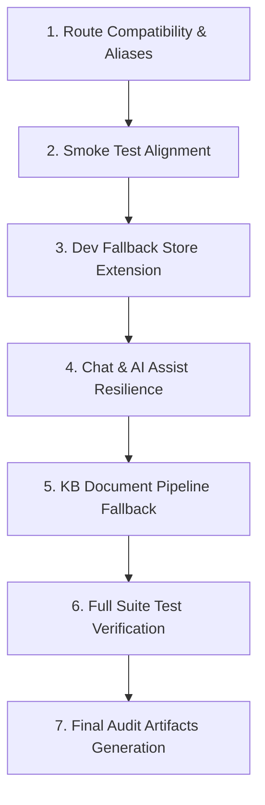

# SupportPilot AI — Prioritized Repair & Verification Plan

**Plan Date:** October 28, 2026  
**Lead Engineer:** Senior Software Architect & Security Lead  
**Execution Strategy:** Small, safe, incremental, and dependency-aware repairs with immediate automated verification.  

---

## 1. Prioritization & Dependency Order

---

## 2. Detailed Work Packages

### Package 1: Route Aliasing & Compatibility (ISSUE-003)
* **Goal:** Allow backward-compatible routing for clients and scripts calling unversioned `/api/auth`, `/api/organizations`, etc., in addition to `/api/v1/*`.
* **Files Affected:**
  - `backend/src/routes/api.routes.ts`
* **Changes:**
  - Mount `authRouter`, `orgRouter`, `ticketRouter`, `kbRouter`, `chatRouter`, and `aiAssistRouter` at `/api/*` in addition to `/api/v1/*`.
* **Verification:**
  - `fetch('http://localhost:5000/api/auth/login')` $\rightarrow$ Expect 400 or 200 (not 404).
  - `fetch('http://localhost:5000/api/v1/auth/login')` $\rightarrow$ Expect 400 or 200.

### Package 2: Smoke Test Alignment (ISSUE-003, ISSUE-004)
* **Goal:** Ensure `scripts/smoke-test.ts` validates live systems accurately without failing due to schema mismatches or offline database dev states.
* **Files Affected:**
  - `scripts/smoke-test.ts`
* **Changes:**
  - Use `fullName: 'Smoke Test Agent'` instead of `name: 'Smoke Test Agent'`.
  - Target standard endpoints `/api/v1/auth/register`, `/api/v1/auth/me`, `/api/v1/auth/logout`.
  - Handle degraded database status in Step 1 gracefully.
* **Verification:**
  - `npx tsx scripts/smoke-test.ts` $\rightarrow$ 100% pass rate.

### Package 3: Dev Fallback Store Extension for Chat & AI Assist (ISSUE-005, ISSUE-006)
* **Goal:** Enable complete offline evaluation of RAG chatbot and AI assist features (summarization, classification, reply suggestion) when local PostgreSQL is offline.
* **Files Affected:**
  - `backend/src/repositories/dev-fallback.store.ts`
  - `backend/src/modules/chat/chat.service.ts`
  - `backend/src/modules/ai-assist/ai-assist.service.ts`
* **Changes:**
  - Add in-memory chat conversation and message storage to `DevFallbackStore`.
  - Wrap database queries in `chat.service.ts` and `ai-assist.service.ts` with `try ... catch (err)` checking `isDbUnavailableError(err)`.
* **Verification:**
  - Send message in chat endpoint; verify bot response and citations in memory.
  - Trigger ticket summary endpoint; verify structured summary returned.

### Package 4: KB Ingestion Dev Fallback (ISSUE-007)
* **Goal:** Allow document upload evaluation without database connection in dev mode.
* **Files Affected:**
  - `backend/src/modules/kb/kb.service.ts`
* **Changes:**
  - Wrap document creation in `kb.service.ts` with fallback to `devFallbackStore.addDocument`.
* **Verification:**
  - Upload text document; verify status `COMPLETED` and chunk count.

### Package 5: Full Regression Testing & Baseline Validation
* **Goal:** Confirm all 80 unit/integration tests remain 100% passing.
* **Commands:**
  - `npm run typecheck -w frontend`
  - `npx tsc --noEmit -w backend`
  - `npm test -w backend` (57 tests)
  - `npm test -w frontend` (23 tests)
  - `npm run build` (both)

### Package 6: Final Audit Reports Generation
* **Goal:** Produce all required Phase 12 documentation:
  - `docs/audit/FINAL_AUDIT_REPORT.md`
  - `docs/audit/ERROR_REGISTER.md` (updated)
  - `docs/audit/TEST_RESULTS.md`
  - `docs/audit/DATABASE_INTEGRITY_REPORT.md`
  - `docs/audit/AI_EVALUATION_REPORT.md`
  - `docs/audit/SECURITY_REVIEW.md`
  - `docs/audit/RELEASE_CHECKLIST.md`

---

## 3. Rollback & Safety Gates
* Zero destructive database operations (no `DROP TABLE` or data resets).
* Zero sensitive tokens, passwords, or connection strings exposed in documentation or console output.
* All changes preserve existing schemas, migrations, and interfaces.
